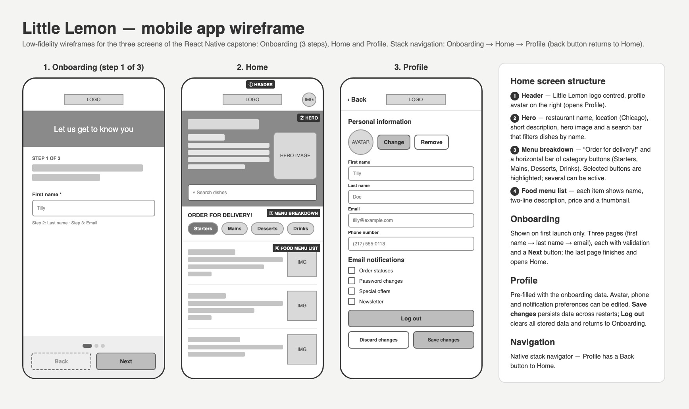

# Little Lemon — React Native capstone

Mobile app for the Little Lemon restaurant (Meta mobile developer capstone), built with **Expo** and **React Native**.



The wireframe is in [`wireframe.jpg`](wireframe.jpg) (source: [`design/wireframe.html`](design/wireframe.html)).

## How to run

Requirements: Node.js 20+ and the **Expo Go** app on a phone (or an iOS Simulator / Android emulator).

```bash
git clone https://github.com/nassipkaliv/littlelemon-native.git
cd littlelemon-native
npm install
npx expo start
```

Then scan the QR code with Expo Go (Android) or the Camera app (iOS), or press `i` / `a` to open a simulator/emulator.
The menu is downloaded from the internet on first launch, so the device needs a connection.

## What to check (review criteria)

| Criterion | Where |
|---|---|
| Wireframe the Home screen is based on | `wireframe.jpg` |
| Onboarding is shown on first launch and asks for personal data | `src/screens/OnboardingScreen.js` |
| Onboarding has 3 pages (first name → last name → email) with a **Next** button | same |
| Home has Header, Hero, Menu breakdown and Food menu list | `src/screens/HomeScreen.js` |
| Hero has a short description of Little Lemon and a search bar | `Hero` component |
| Menu breakdown has a bar of category buttons (selected ones are highlighted) | `MenuBreakdown` component |
| Menu list shows name, description, price and image of each dish | `MenuItem` component |
| Profile is pre-filled with the onboarding data | `src/screens/ProfileScreen.js` |
| Saved Profile changes persist after restarting the app (AsyncStorage) | `src/ProfileContext.js` |
| **Log out** deletes all data and returns to Onboarding | `logout()` in `src/ProfileContext.js` |
| Stack navigation with a Back button (Home → Profile → back) | `App.js` |

## Features

- **Onboarding** – 3 steps with validation, progress dots, Back/Next buttons. Shown only until it's completed.
- **Home** – menu fetched from the [course API](https://raw.githubusercontent.com/Meta-Mobile-Developer-PC/Working-With-Data-API/main/capstone.json), cached in **SQLite** (`expo-sqlite`); search by name (debounced) and filter by one or more categories are done with SQL queries.
- **Profile** – avatar from the photo library (`expo-image-picker`) or initials placeholder, first/last name, email, US phone number with mask, email notification checkboxes, **Save changes** / **Discard changes**, **Log out** (with confirmation).
- The header avatar opens the Profile screen; the native Back button returns to Home.

## Project structure

```
App.js                      navigation (native stack) + providers
src/ProfileContext.js       profile state, AsyncStorage persistence, logout
src/database.js             SQLite menu cache and filtering
src/validation.js           name / email / phone validation and phone mask
src/screens/                Onboarding, Home, Profile
src/components/             Logo, Avatar, Button
assets/                     logo, hero image, icons
```
